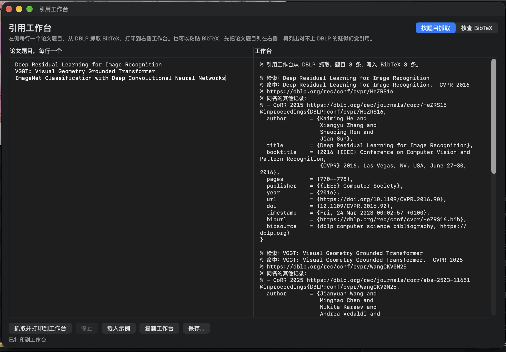
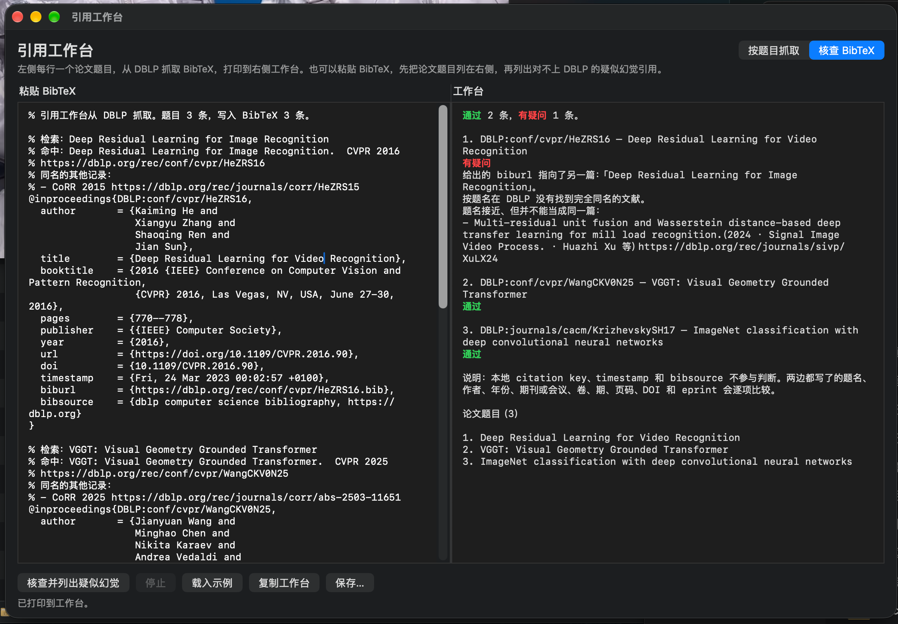

# 引用工作台

macOS 上的文献小工具。给定论文题目，从 [DBLP](https://dblp.org) 抓取 BibTeX；也可以粘贴已有的 BibTeX，逐条对照 DBLP，标出通过或有疑问的引用。

需要 macOS 14 或更高版本。

## 界面

按题目抓取。左侧每行一个题名，右侧工作台打印 BibTeX。



核查 BibTeX。对得上的显示加粗绿色「通过」，对不上的显示加粗红色「有疑问」。论文题目印在文末。



## 功能

- **按题目抓取**：只采用题名完全一致的 DBLP 记录。同一题名既有会议或期刊版本、又有预印本时，优先会议或期刊版本，并在注释里列出其他同名记录。找不到完全同名的文献时，只给出接近的候选，不会把另一篇写成这条引用。
- **核查 BibTeX**：跳过 `@String`。对照题名、作者、年份、期刊或会议、卷、期、页码、DOI 和 eprint。本地 citation key、`timestamp`、`bibsource` 不参与判断。
- 正在处理第 N 条时，前 N−1 条已经显示在工作台上。
- 每次点核查都会重新查询 DBLP，不会因为以前查过就跳过。
- 查询大约每 1.2 秒一条，避免给 DBLP 造成压力。

## 使用

用 `./build.sh` 生成应用后，双击上一级目录中的 `引用工作台.app`。

1. **抓取**：选「按题目抓取」，每行写一个论文题名，点「抓取并打印到工作台」。
2. **核查**：选「核查 BibTeX」，粘贴文献，点「核查并列出疑似幻觉」。
3. 「载入示例」会填入 `testdata` 里的题目或测试文献。
4. 「复制工作台」和「保存…」导出右侧内容。纯文本保存，不包含颜色。

菜单里可以用 ⌘R 开始，⌘. 停止。

## 从源码构建

需要安装 Xcode 命令行工具（提供 `swiftc`）。在本目录执行：

```bash
./build.sh
```

脚本会编译 `Sources` 下的 Swift 文件，生成图标，并在上一级目录写出 `引用工作台.app`。

命令行也可以直接调用应用：

```bash
引用工作台 --fetch titles.txt
引用工作台 --verify sample.bib
引用工作台 --self-test
```

`--fetch` 和 `--verify` 的进度打在标准错误，结果打在标准输出。

## 目录

| 路径 | 内容 |
| --- | --- |
| `Sources/` | 界面、BibTeX 解析、DBLP 查询与核查 |
| `Tools/MakeIcon.swift` | 生成应用图标 |
| `Support/Info.plist` | 应用信息 |
| `testdata/titles.txt` | 示例题目 |
| `testdata/sample.bib` | 示例 BibTeX，内容是公开论文记录 |
| `asset/` | README 用的界面截图 |
| `build.sh` | 构建脚本 |

## 网络与本地数据

程序只访问 `https://dblp.org`。发出去的是你输入的题名，以及 BibTeX 里用来对照的字段（题名、作者、年份、会议或期刊、页码、DOI 等）。没有账号，也不读取通讯录、邮件或文件里的其他内容。

DBLP 有时会先显示一次公开的浏览器校验。程序完成这次校验后再取文献，并把当次校验留下的短期 cookie 写在本机：

`~/Library/Caches/引用工作台/`

这个缓存目录不在仓库里。按题目抓取时会复用其中的文献缓存；核查不会复用，每次都重新查询。不要把这个缓存目录提交到 Git。

仓库里没有密钥、口令或个人联系方式。`testdata/sample.bib` 和截图中的条目都是已发表论文的公开著录。应用标识是 `com.wcy.citationbench`，写在 `Support/Info.plist` 里；如果要换成别的标识，改这一处即可。
